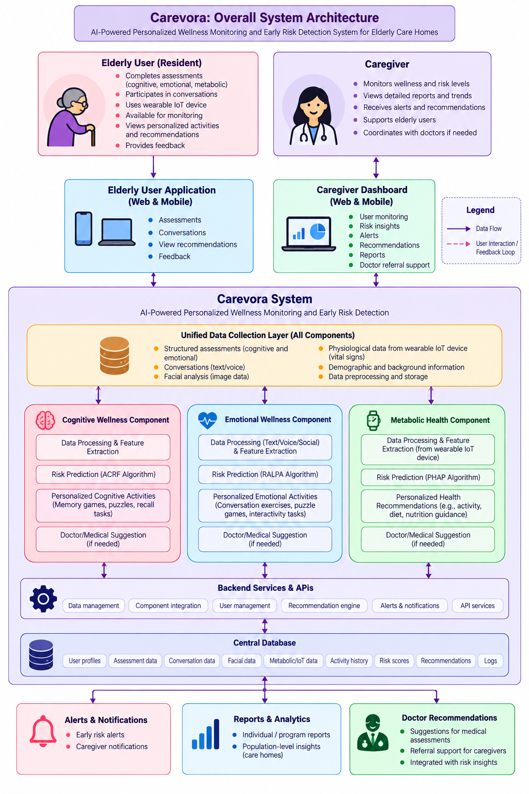

# 🏡 Carevora

**AI-Powered Personalized Wellness Monitoring and Early Risk Detection System for Elderly Care Homes**

**Project Code:** J26-IT-421  
**Degree:** B.Sc. (Hons) in Information Technology  
**Institution:** Sri Lanka Institute of Information Technology (SLIIT)

---

## 🌿 About Carevora

Carevora is an AI-powered elderly-care support platform designed to assist caregivers in monitoring the emotional, cognitive, and metabolic well-being of elderly residents.

The platform brings together AI-assisted assessments, machine-learning-based risk prediction, explainable insights, personalized support, and caregiver decision support.

> **Important:** Carevora is an academic research and decision-support system. It is not a medical diagnostic system and does not replace professional healthcare services.

## 🔬 Research Components

### 💙 Component 1 — Emotional Wellness, Social Isolation & Loneliness Trajectory Prediction

This component focuses on identifying changes in the emotional and social well-being of elderly residents and predicting future loneliness and social-isolation trajectories.

**Key features**
- AI-assisted structured conversation
- Facial and vocal emotional analysis
- Questionnaire-based assessment and social-behavioural indicators
- Resident-specific baseline modelling and baseline-deviation detection
- Longitudinal trend analysis and future trajectory prediction
- Explainable risk factors, personalized activity recommendations, and caregiver alerts
- Post-intervention reassessment

**Proposed algorithm: RALPA — Resident-Adaptive Longitudinal Prediction Algorithm**

RALPA is designed to support resident-specific longitudinal analysis by considering historical observations, personal baseline patterns, deviations from baseline, and temporal trends before predicting future risk trajectories.

### 🧠 Component 2 — Cognitive Wellness Monitoring & Early Cognitive Decline Prediction

This component focuses on AI-assisted cognitive assessment and early cognitive-risk prediction among elderly residents.

**Key features**
- AI-assisted cognitive assessment
- Memory, attention, orientation, recall, and reasoning-related indicators
- Speech and response processing
- Cognitive feature extraction and risk prediction
- Explainable AI, personalized cognitive activities, and caregiver alerts
- Follow-up reassessment

**Proposed algorithm: ACRF — Adaptive Cognitive Risk Fusion**

ACRF is designed to combine relevant cognitive indicators into a unified representation before machine-learning-based cognitive-risk prediction.

### ❤️ Component 3 — Metabolic Health Risk Prediction

This component focuses on AI-assisted monitoring and prediction of relevant metabolic-health risks among elderly residents.

**Key features**
- Health-related data processing
- Machine-learning-based risk prediction and monitoring
- Explainable risk information
- Personalized support and caregiver decision support

## 🏗️ System Architecture

The diagram below illustrates how residents and caregivers interact with the Carevora applications, how information flows through the unified data collection layer and the three wellness components, and how backend services support the database, alerts, reports, and recommendations.



*Figure: Carevora overall system architecture.*

## 🛠️ Technology Stack

| Area | Technologies |
|---|---|
| Main frontend | Flutter, Dart |
| Additional web portal | Next.js 15, React, TypeScript, Tailwind CSS |
| Backend | Java, Spring Boot, Gradle |
| AI / ML service | Python, FastAPI, Uvicorn, machine-learning libraries |
| Database | H2 Database |
| API documentation | Swagger UI / OpenAPI |
| Development tools | Git, Android Studio / VS Code |

## 📁 Project Structure

```text
CAREVORA-J26-IT-421/
│
├── carevora-ai-service/          # Python AI/ML microservice
│   ├── carevora_risk/
│   │   ├── features.py
│   │   ├── portable.py
│   │   ├── predictor.py
│   │   └── __init__.py
│   ├── data/
│   ├── models/
│   ├── notebooks/
│   ├── tests/
│   ├── audio_analyzer.py
│   ├── carevora_acrf.py
│   ├── cognitive_engine.py
│   ├── ralpa_engine.py
│   ├── vision_analyzer.py
│   ├── main.py
│   └── requirements.txt
│
├── carevora-backend/             # Spring Boot backend
│   ├── src/
│   │   ├── main/
│   │   │   ├── java/com/carevora/
│   │   │   │   ├── config/
│   │   │   │   ├── controller/
│   │   │   │   ├── dto/
│   │   │   │   ├── entity/
│   │   │   │   ├── enums/
│   │   │   │   ├── exception/
│   │   │   │   ├── repository/
│   │   │   │   ├── security/
│   │   │   │   └── service/
│   │   │   └── resources/
│   │   │       └── application.properties
│   │   └── test/
│   ├── build.gradle
│   └── pom.xml
│
├── carevora-web/                 # Next.js 15 web portal
│   ├── app/
│   │   ├── dashboard/
│   │   │   ├── alerts/
│   │   │   ├── care-plans/
│   │   │   ├── cognitive/
│   │   │   ├── emotional/
│   │   │   ├── metabolic/
│   │   │   ├── reports/
│   │   │   ├── residents/
│   │   │   └── settings/
│   │   ├── login/
│   │   ├── globals.css
│   │   └── layout.tsx
│   ├── components/
│   ├── lib/
│   ├── public/
│   └── package.json
│
├── lib/                           # Flutter application source
│   ├── core/
│   │   ├── config/
│   │   ├── responsive/
│   │   ├── router/
│   │   ├── services/
│   │   ├── theme/
│   │   └── utils/
│   ├── data/
│   ├── features/
│   │   ├── admin/
│   │   ├── assessment/
│   │   ├── auth/
│   │   ├── dashboard/
│   │   ├── doctor/
│   │   ├── landing/
│   │   ├── medicine/
│   │   ├── metabolic/
│   │   └── splash/
│   ├── shared/
│   └── main.dart
│
├── android/
├── assets/
├── test/
├── web/
├── analysis_options.yaml
├── CARE_VORA_AUDIT_REPORT.md
├── pubspec.yaml
└── README.md
```

## 🚀 Running the Application Locally

The following instructions reflect the current local development setup on **Windows using PowerShell**. Start each service in a separate terminal and leave the terminal running while using the application.

### Prerequisites

- Flutter SDK (with web support enabled)
- Java JDK compatible with the Spring Boot project
- Python 3
- Git

Check that the tools are available:

```powershell
flutter --version
java -version
python --version
git --version
```

### 1. Start the Flutter Web frontend

Run this command from the **repository root** (the folder containing `pubspec.yaml`):

```powershell
flutter run -d chrome --web-port=52357
```

Open the application:

- **Frontend:** [http://localhost:52357](http://localhost:52357)

### 2. Start the Spring Boot backend

Open a new PowerShell terminal and move into the backend directory:

```powershell
cd carevora-backend
```

Start the backend using the Gradle wrapper:

```powershell
.\gradlew.bat bootRun
```

Backend URLs:

| Service | URL |
|---|---|
| Backend base URL | [http://localhost:8081](http://localhost:8081) |
| Health check | [http://localhost:8081/actuator/health](http://localhost:8081/actuator/health) |
| Swagger UI | [http://localhost:8081/swagger-ui.html](http://localhost:8081/swagger-ui.html) |
| H2 Console | [http://localhost:8081/h2-console](http://localhost:8081/h2-console) |

A healthy backend responds to the health-check endpoint with:

```json
{
  "status": "UP"
}
```

**H2 database connection:** The JDBC URL supplied for the current setup is:

```text
jdbc:h2:mem:carevora_db
```

Use the JDBC URL, username, and password configured in `carevora-backend/src/main/resources/application.properties` when signing in to the H2 console. H2 console access and database persistence depend on that configuration. An H2 `mem:` URL is in-memory; a `file:` URL is a different, file-backed configuration.

### 3. Start the Python AI service

Open another PowerShell terminal and move into the AI service directory:

```powershell
cd carevora-ai-service
```

Create and activate a virtual environment (recommended):

```powershell
python -m venv venv
.\venv\Scripts\Activate.ps1
```

Install the Python dependencies:

```powershell
pip install -r requirements.txt
```

Start the FastAPI service with Uvicorn:

```powershell
$env:OMP_NUM_THREADS="1"
python -m uvicorn main:app --host 127.0.0.1 --port 8000
```

The AI service will be available at:

- **AI service:** [http://127.0.0.1:8000](http://127.0.0.1:8000)
- **Interactive API documentation:** [http://127.0.0.1:8000/docs](http://127.0.0.1:8000/docs), if the FastAPI application exposes the default documentation route.

Keep the AI service terminal open while using features that depend on it.

### 4. Optional: Next.js web portal

The repository also contains a separate Next.js application in `carevora-web/`. It is separate from the Flutter Web startup command above.

To run it, open a new terminal:

```powershell
cd carevora-web
npm install
npm run dev
```

Use the URL printed by Next.js in the terminal. The default development port is commonly `3000`, unless the project configuration or an existing process selects another port.

## 🔌 Service Summary

| Service | Technology | Local address | Startup command |
|---|---|---|---|
| Main frontend | Flutter Web | `http://localhost:52357` | `flutter run -d chrome --web-port=52357` |
| Backend | Spring Boot | `http://localhost:8081` | `.\gradlew.bat bootRun` |
| AI service | FastAPI / Uvicorn | `http://127.0.0.1:8000` | `python -m uvicorn main:app --host 127.0.0.1 --port 8000` |
| Additional web portal | Next.js | URL printed by Next.js | `npm run dev` |

## 🔐 Security & Privacy

Carevora processes sensitive elderly-care information. Development and deployment should follow these practices:

- Use authentication and role-based access control where implemented.
- Protect resident information and restrict access to authorized users.
- Keep credentials and secrets out of source control.
- Store sensitive configuration in environment variables or local configuration files excluded from Git.
- Do not commit passwords, API keys, tokens, or private database credentials.
- Use secure transport and appropriate access controls when deploying outside a local development environment.

## 📊 Research Evaluation

Potential evaluation measures and activities include:

**Machine-learning evaluation**
- Accuracy, precision, recall, and F1-score
- ROC-AUC and confusion matrix
- Cross-validation

**Emotional wellness evaluation**
- Resident-specific baseline performance
- Baseline-deviation detection
- Longitudinal trend analysis
- Future trajectory prediction
- Ablation studies
- Post-intervention reassessment

**System evaluation**
- Functional testing
- Integration testing
- Usability testing
- Caregiver-oriented evaluation

## 👥 User Roles

### Elderly Resident
- Participate in AI-assisted assessments
- Interact with the system
- Complete personalized activities
- Participate in reassessment

### Caregiver
- Manage residents
- View assessment results and risk levels
- Review historical trends and predicted trajectories
- View contributing factors
- Receive alerts and review recommendations
- Monitor follow-up responses

## 🧪 Development Status

The services have local startup commands and health/documentation URLs as listed above. The availability of a running service does not, by itself, mean that every research feature or model is complete.

Update the status of individual modules as implementation and testing progress:

| Module | Status |
|---|---|
| Flutter Web application | In development |
| Spring Boot backend | In development |
| H2 database integration | In development |
| Next.js web portal | In development |
| Emotional wellness | Research development |
| Cognitive wellness | Research development |
| Metabolic health | Research development |
| AI / ML service | Research development |
| RALPA | Research development |
| ACRF | Research development |
| Explainable AI | Research development |
| Personalized recommendations | Research development |
| Testing | Planned |
| Deployment | Planned |

## 📚 Academic Context

This repository contains the software implementation and research-related development of the J26-IT-421 undergraduate research project at the Sri Lanka Institute of Information Technology.

The repository supports the development of the Carevora platform and its individual research components.

## ⚠️ Disclaimer

Carevora is developed for academic research and software-development purposes. The system provides AI-assisted monitoring, prediction, recommendations, and caregiver decision-support information. It does not provide medical diagnosis and should not replace professional medical assessment, treatment, or clinical judgement.

---

🏡 **Carevora**  
*AI • Wellness • Prediction • Personalization • Elderly Care*

Supporting caregivers with intelligent, personalized, and explainable AI-assisted elderly wellness monitoring.
